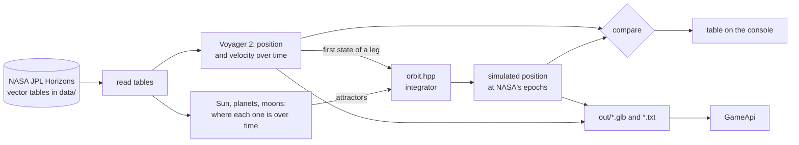
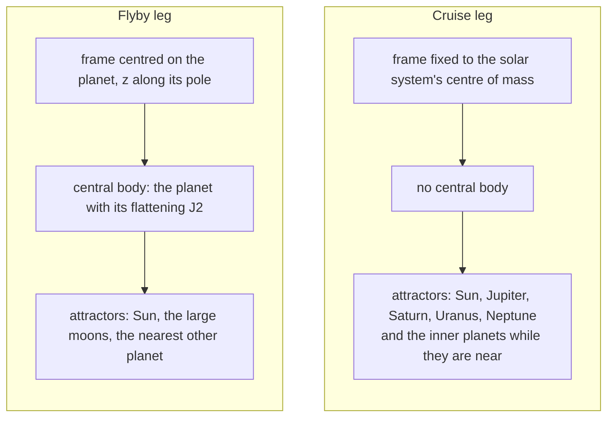
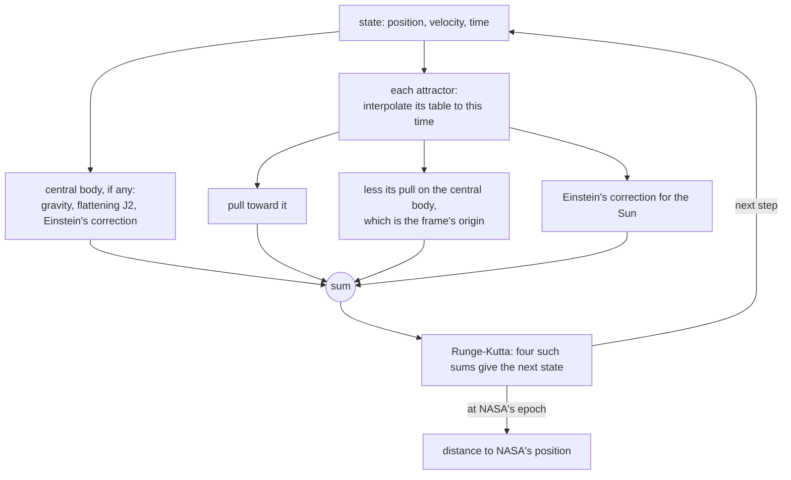

# Voyager 2, simulated

Voyager 2's route from 1977 to 2026, flown by a small orbit library under gravity alone and compared with NASA's own trajectory. The point is to show that the library (`orbit/orbit.hpp`, one header) is general: the same integrator that carries a navigation satellite around the Earth carries a probe past four planets.

## Run it

```
git clone --recurse-submodules https://github.com/henris42/solaris.git     # GameApi is a submodule; it is only needed for the game
./run.sh
```

Needs a C++20 compiler and nothing else. It takes about 15 seconds, prints the table below and writes the 3D views to `out/`.

## Result

The route is flown in nine legs. Each leg starts from NASA's position and velocity and is then on its own. "Error" is the distance between the simulated spacecraft and NASA's at the same moment.

| Leg | From | Days | Path | Largest error | Error / path |
|---|---|---|---|---|---|
| Earth to Jupiter | 1977-09-01 | 670 | 1 070 million km | 1 574 655 km | 1 in 679 |
| Jupiter flyby | 1979-07-05 | 9 | 10.4 million km | 6 506 km | 1 in 1 601 |
| Jupiter to Saturn | 1979-07-14 | 770 | 1 159 million km | 12 750 km | 1 in 90 886 |
| Saturn flyby | 1981-08-22 | 8 | 9.0 million km | 9 811 km | 1 in 916 |
| Saturn to Uranus | 1981-08-30 | 1600 | 2 642 million km | 2 142 270 km | 1 in 1 233 |
| Uranus flyby | 1986-01-21 | 7 | 9.1 million km | 27 km | 1 in 334 948 |
| Uranus to Neptune | 1986-01-28 | 1300 | 2 161 million km | 3 088 630 km | 1 in 700 |
| Neptune flyby | 1989-08-22 | 6 | 8.9 million km | 41 km | 1 in 219 335 |
| Neptune to 2026 | 1989-08-28 | 13 500 | 18 277 million km | 2 412 224 km | 1 in 7 577 |

Controls, flown by the same code: bodies whose NASA paths are gravity alone.

| Control | Days | Path | Largest error | Error / path |
|---|---|---|---|---|
| Uranus | 18 080 (49 years) | 10 391 million km | 474 km | 1 in 21.9 million |
| Tethys, a moon of Saturn | 10 | 9.8 million km | 113 km | 1 in 87 056 |
| Tethys, with Saturn taken as round | 10 | 9.8 million km | 19 595 km | 1 in 500 |

The flybys, with and without the planet's flattening (J2):

| Flyby | Nearest | From the centre | Path turned by | Error with J2 | Without |
|---|---|---|---|---|---|
| Jupiter | 1979-07-09 22:30 | 721 336 km | 91.9° | 6 506 km | 6 993 km |
| Saturn | 1981-08-26 03:20 | 160 721 km | 84.6° | 9 811 km | 177 km |
| Uranus | 1986-01-24 18:00 | 107 155 km | 23.0° | 27 km | 103 km |
| Neptune | 1989-08-25 04:00 | 29 599 km | 54.0° | 41 km | 6 415 km |

Times are TDB, to the nearest 10 minutes of NASA's table.

## What the numbers say

- **The model is sound.** It follows Uranus for 49 years to 474 km and Tethys for 10 days to 113 km. Anything much larger on a Voyager leg is therefore not a fault of the gravity model.
- **Uranus and Neptune flybys fit to tens of kilometres**, and only with the planet's flattening in the model. Neptune without it is off by 6 415 km: Voyager passed 4 800 km above the cloud tops.
- **The cruise legs drift by millions of kilometres.** The spacecraft corrected its course with its thrusters many times, and none of that is in a gravity model. A velocity change of one metre per second is 86 km a day.
- **Jupiter: an engine burn is visible.** In a separate check (not part of this program) NASA's trajectory changes its velocity by about 13 m/s within hours after the closest approach, in a way gravity does not account for. That is the size and shape of a course correction; we have not looked it up in the mission log.
- **Saturn: NASA's file fits a round Saturn.** With Saturn's flattening the simulation is 9 811 km off, without it 177 km. The flattening itself is right in our model: Tethys needs it (113 km against 19 595 km). So this stretch of the trajectory in Horizons behaves as if it had been computed without Saturn's flattening. We cannot confirm that from NASA's documentation.
- **Einstein does not matter here.** The relativistic correction is in the model. Switching it off changes the first leg by 170 km out of 1.5 million, the other legs by a few kilometres, the flybys by 0.1 km.

## How it works



A leg is flown in one of two frames, and that is the only difference between a cruise and a flyby:



Between two of NASA's epochs the integrator takes fixed steps (fourth-order Runge-Kutta). In every step it asks four times for the acceleration:



The step is 5 to 20 seconds in a flyby and one to six hours in a cruise. Halving every step changes the errors above by 11 km at most, on legs that are off by millions.

## Fly along: the game


`./play.sh [jupiter|saturn|uranus|neptune]` opens a GameApi window and plays that system's tour: three minutes from arrival to departure, with every flyby in it, of the planet and of each moon Voyager 2 passed.


Time runs slowly near things and fast between them, without steps: the planet grows at an even pace on the way in (the slowness is as one over its distance), every moon gets the same share of the three minutes around its nearest approach, and the planet shrinks again behind, a crescent. The view is on the body whose flyby it is, otherwise on the planet, through the camera Voyager would use for a body of that size in the sky: its narrow-angle camera (0.42 degrees wide) while the body is small, its wide-angle camera (3.2 degrees) as it grows, and the eye beside the spacecraft for what fills the sky. The view swings from one body to the next, and a change of camera is a glide of about a second from one lens to the other, not a cut. Through a camera the spacecraft is drawn beside the picture.

| Tour | Flybys, in order, with the nearest distance from the body's centre |
|---|---|
| Jupiter, July 1979 | Callisto 215 028 km, Ganymede 62 063 km, Europa 205 532 km, Jupiter 721 336 km, Io 1 129 435 km |
| Saturn, August 1981 | Iapetus 908 042 km, Titan 665 536 km, Dione 501 840 km, Mimas 309 412 km, Saturn 160 721 km, Enceladus 87 581 km, Tethys 93 363 km, Rhea 644 399 km |
| Uranus, January 1986 | Titania 364 408 km, Oberon 469 492 km, Ariel 127 298 km, Miranda 28 600 km, Uranus 107 155 km, Umbriel 324 445 km |
| Neptune, August 1989 | Neptune 29 599 km, Triton 39 754 km |

These distances come out of the simulation; the terminal lists them with their dates when a tour starts.

### What Voyager 2 photographed

`a` switches to the autonomous view: the picture follows Voyager 2's own. NASA's Planetary Data System keeps the record of every picture its two cameras took (Ring-Moon Systems Node, `opus.pds-rings.seti.org`): the time, the camera, what it was aimed at and where in the sky the camera pointed. During the days of the four scenes that is 7 764 pictures (`data/shots_<planet>.txt`). The view goes to where the camera pointed for each picture in turn, through the camera that took it (softened a little so that the eye can follow; the amber corners are the edges of the square picture), and the panel names the target and counts the pictures. `a` again, or picking a body, returns to the tour's view.

This is also a check on everything at once (the simulation, the frames of the planets, the clocks): the record is NASA's, the positions of the bodies are the simulation's. Of the pictures aimed at a body of the scenes, the body is inside the picture where the simulation puts it in:

| | pictures aimed at a body of the scene | with the body in the picture |
|---|---|---|
| Jupiter | 3 525 | 3 449 |
| Saturn | 1 089 | 1 082 |
| Uranus | 757 | 728 |
| Neptune | 864 | 830 |

The rest are not looked into (pictures of a limb, of rings recorded under the planet's name, or misses).

On the screen, besides the picture:

- top left, what the spacecraft is doing: the date, its distance from the planet's centre and above its cloud tops, its speed past the planet, how fast time runs, what the picture is seen through, and the body the tour is on;
- top right, every body it passes: how far it is now, how near it comes, and how long until (or since) the nearest approach;
- bottom left, where it is: two maps of the planet's system to scale, from above the planet's north pole and from the side, with the moons and their paths, Voyager's path (behind it solid, ahead faint), the direction of the Sun and a scale bar. Both maps have the direction Voyager came from on the left, and both close in as Voyager nears the planet.

| | |
|---|---|
| drag with the mouse | turn the eye about the spacecraft; the turn glides on a little after the mouse lets go. Through a camera the picture stays on its body and only the spacecraft turns |
| wheel, `c` | nearer to the spacecraft, farther; the eye back to where it started |
| click a name | a planet (top middle): that system. A body in the list (top right): look at it; it holds until the tour moves on |
| Tab, `f` | look at the next body in the list, at the planet |
| `,` `.` | to the previous, the next flyby |
| `1` to `9` | time at one rate: `1` is real time, then 10, 30, 100, 300, 1 000, 3 000, 10 000 and 30 000 times |
| `t` or `0` | time at the tour's own pace again |
| `+` `-`, space | faster, slower; pause |
| `a` | autonomous: follow what Voyager 2 photographed (see above) |
| `z` | by eye, wide-angle camera, narrow-angle camera |
| `v`, `m`, `i` | the spacecraft, the maps, the data panels: on or off |
| `j` `s` `u` `n` | Jupiter, Saturn, Uranus, Neptune |
| `r`, Esc | start of the scene, quit |

`./play.sh saturn -14 60` starts without the tour, 14 hours before the nearest approach to Saturn at 60 times real speed; `./play.sh jupiter ganymede 1` starts at Ganymede's nearest approach in real time.

True to life: the direction and apparent size of every body at every moment (from the simulation), the stars (the Hipparcos catalogue: each star a dot at its measured place, as bright as measured, with a hint of its measured colour; 8 870 stars to magnitude 6.5 for the eye, to magnitude 8 and 9 through the cameras; one star field serves all four planets, with every star where it was in 1984), the planets in visible light, which side of each body is in sunlight, the planet's turning, Saturn's rings, the spacecraft's shape and surface with its dish toward the Earth and the sunlight on it (the dish's open face lit, the far side and what lies in the dish's shadow not), the fields of its two cameras: a camera magnifies the whole picture, stars included, so through the narrow-angle camera there is seldom a star in view.

Not true to life: time; the Sun, drawn at least a fifth of a degree wide (and plain white); the unlit side of everything, which in space is black and here keeps a fifth of its brightness so that it can be seen; no shadows of one body on another (of Saturn on its rings, of a planet on a moon); the moons' maps are not turned to the face each moon really showed; parts of some moons are made up (see below); how the spacecraft is rolled about its dish; sunlight on the spacecraft comes from where the Earth is (from out there the two are a few degrees apart); the brightness of the stars is squeezed into what a screen can show. GameApi's own camera is a long lens, 17 degrees from top to bottom.

Made-up ground. Nobody has seen all of these moons: Voyager 2 passed Uranus's moons and Triton with their northern parts in the dark, and no spacecraft has been back. Where a map is black for that reason, the game does not show a hole: `tools/fill.cpp` fills it with ground made to look like the part that was seen. It takes the seen surface's brightness (the same distribution), its colours (each brightness gets the colour the seen surface has there) and its roughness (which sets the fractal dimension), and makes fractal noise on the sphere plus craters whose number falls with the square of their size, each drawn as light falls on a bowl with a rim. It is a guess, not a map:

| | made up |
|---|---|
| Miranda, Ariel, Umbriel, Titania, Oberon | about 60 % of each: the northern half |
| Triton | 39 %: the north |
| Europa, Ganymede, Callisto | 5 % each: strips at the poles |
| Io, Titan, Saturn's moons | nothing |

It has been played by hand (the scene keys worked) and otherwise run on a virtual screen, where these pictures were taken. The first picture comes about a second after the start, and so does another planet.

A note on starting. GameApi is used from its `more_stable` branch, which its author recommends (the submodule points there). On its `master` branch about one start in ten failed: the window stayed black at "loading", every thread of the program asleep waiting for another (GameApi reads models on several threads), or the program stopped with an out-of-memory error. On `more_stable`, of some forty starts on the virtual screen none hung, and one stopped in its first seconds with broken memory (`malloc(): unaligned tcache chunk detected`); the next thirty were fine. The first picture also comes ten times sooner. The engine is not changed here; the game keeps a watch on the side instead, which starts the program afresh when no picture has been drawn for 45 seconds, or when it is about to stop on an error or a fault within two minutes of its start, three times at most (`start_afresh` in `game.cpp`). The restart has been seen to work on a fault sent from outside during loading (`kill -ABRT`, `kill -SEGV`); a restart after a real failed start has not come up in a test yet. Keys, clicks and drags are tested on the virtual screen with made-up events (`-DGAME_TEST`, see the top of `game.cpp`).

Building GameApi on Ubuntu: `sudo apt-get install libsdl2-dev libsdl2-mixer-dev libglew-dev libfreetype-dev libopencv-dev` (its own README does not list the last one), then `make -j 8 depbuild` in `GameApi/GameApi`. GameApi asks for an antialiased window, which some X servers give only through EGL; `play.sh` sets `SDL_VIDEO_X11_FORCE_EGL=1` for that.

How the game draws, in GameApi's terms: every body is its own model with its own matrix, set anew each frame. GameApi scales each model it loads to 400 units across; the first triangle of each of our files spans the model's box so that this is exact. The stars are drawn first (three files, one for the eye and one for each camera, every star a small square with a soft dot on it; read once and turned into each planet's frame, which GameApi does with three turns worked out and checked at the start), then the bodies with the eye at the spacecraft, each at a distance that keeps their order and with the size that gives its true apparent size, then the spacecraft. A camera is a scaling of the whole picture, 5.4 or 40 times. Sunlight on a body is a second ball over it, turned to the Sun, clear on the day side and darkening to the night side. Sunlight on the spacecraft is in its textures (`tools/undraco.py`). The panels and maps are drawn last, in plain OpenGL (`panels.hpp`), with letters from `glyphs.hpp`.

## The overview views

`out/` also holds six views as glTF files (`.glb`), each centred and scaled to 150 units, with a GameApi script of the same name (`.txt`): `route-planets` (1977 to 1989), `route-whole` (to 2026) and the four flybys in the planet's own frame with the planet and moons to scale. The blue line is the simulated trajectory; planet orbits are grey, moon orbits orange. From `out/`:

```
SDL_VIDEO_X11_FORCE_EGL=1 LD_LIBRARY_PATH=../GameApi/GameApi ../GameApi/GameApi/cmdline/gameapi_cmdline --file neptune.txt
```

## Files

| | |
|---|---|
| `voyager2.cpp` | the simulation: the legs, the comparison, the glTF writer, the game's data |
| `game.cpp`, `play.sh` | the game, on GameApi |
| `panels.hpp`, `glyphs.hpp` | flat drawing over the picture (boxes, lines, text) and its letters; `tools/font.sh` wrote the letters |
| `orbit/orbit.hpp` | the orbit library (a copy; one header, no dependencies) |
| `data/` | 38 vector tables from NASA JPL Horizons, the stars to magnitude 9 (`stars.txt`) and Voyager 2's picture record (`shots_*.txt`); `fetch.sh` fetches them again |
| `textures/` | surface maps; `fetch-textures.sh` fetches and prepares them again |
| `tools/fill.cpp` | makes up the unseen parts of the moons' maps |
| `models/probe/` | NASA's Voyager model in three plain glTF parts, each with its texture; `tools/undraco.py` made them from `models/voyager-probe-b.glb` and put the sunlight in |
| `screens/` | pictures from the game |
| `GameApi/` | the engine, as a git submodule (its `more_stable` branch) |
| `run.sh` | builds and runs the simulation |

## Not in the model

Thrust, radiation and heat recoil, flattening beyond J2, rings and small moons, and everything else that is not gravity of point masses, one flattened planet and Einstein's first correction. The simulation does not predict the route from the launch alone: each leg starts from NASA's state, and a leg ends where the next begins.

## Sources

- Trajectory of Voyager 2 and positions of the Sun, planets and moons: NASA JPL Horizons (`ssd.jpl.nasa.gov/horizons`), fetched 2026-11-15. Masses from the same service.
- Planet poles: IAU working group on cartographic coordinates. Flattening (J2) with its reference radius: published gravity fields of the planets. Both are written out in `voyager2.cpp`.
- Spacecraft model: NASA 3D Resources (`github.com/nasa/NASA-3D-Resources`, "Voyager Probe (B)"), which NASA describes as free and without copyright; unpacked from its mesh compression for GameApi.
- Moon maps. Io, Europa, Ganymede, Callisto and Triton: the U.S. Geological Survey's global mosaics from Galileo and Voyager pictures (public domain, `astrogeology.usgs.gov`). Io's colours come from Galileo's violet, green and near-infrared filters (to the eye Io is the same but paler); Europa and Callisto are grey mosaics given one tint each; Triton's colours are the mosaic's own, which are stretched. Mimas, Enceladus, Tethys, Dione, Rhea and Iapetus: the Cassini maps of 2014 (NASA/JPL-Caltech/Space Science Institute/Lunar and Planetary Institute, PIA18434 to PIA18439), their stretched colours brought down to the near white of ice and brightened. Titan and Uranus's five moons: NASA 3D Resources, "Images and Textures", the same terms as the spacecraft model; Titan brought from a strong red-orange to the tan-orange of its haze in visible light. Unseen parts are made up, as said above.
- Planet and ring maps in visible light: Solar System Scope (`solarsystemscope.com/textures`), licence CC BY 4.0, made from NASA data.
- Stars: the Hipparcos catalogue (ESA, 1997; CDS catalogue I/239), every star to magnitude 9: position, proper motion, parallax, brightness and colour.
- What Voyager 2 photographed: NASA Planetary Data System, Ring-Moon Systems Node, OPUS (`opus.pds-rings.seti.org`), the Voyager ISS image record: time, camera, target and pointing of each picture.
- Letters on the screen: DejaVu Sans Mono (Bitstream Vera licence), as small pictures in `glyphs.hpp`.
- GameApi: by its author, under its own licence (GPL and LGPL), used here with the author's consent.

## Licence

Our own files (the simulation, the game, `orbit/orbit.hpp`, the scripts) are under the Apache License 2.0, see `LICENSE`. The data, the maps, the spacecraft model and GameApi are their owners' and keep the terms listed under Sources.
