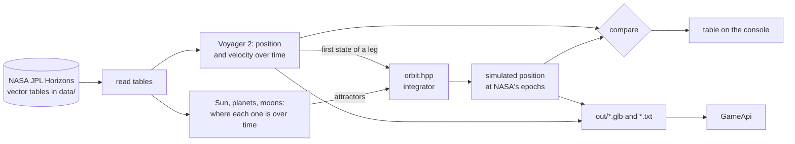
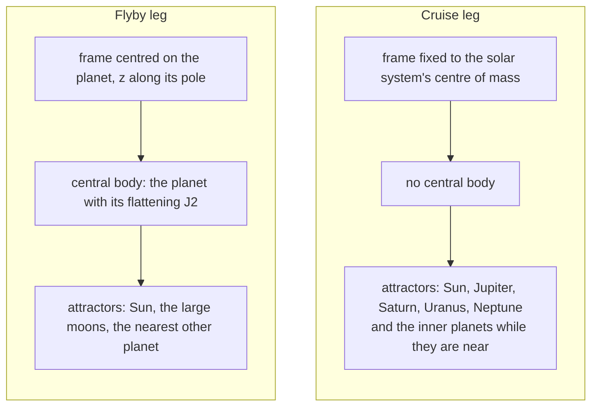
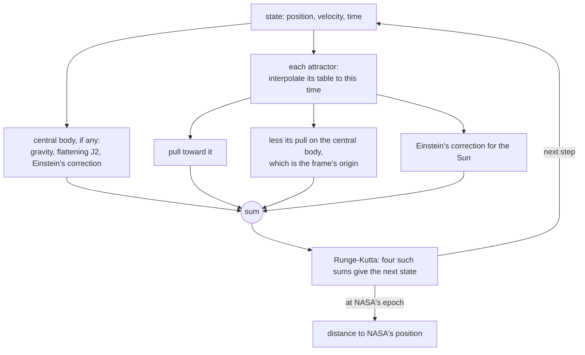

# Voyager 2, simulated

Voyager 2's route from 1977 to 2026, flown by a small orbit library under gravity alone and compared with NASA's own trajectory. The point is to show that the library (`orbit/orbit.hpp`, one header) is general: the same integrator that carries a navigation satellite around the Earth carries a probe past four planets.

## Run it

```
git clone --recurse-submodules <this repository>     # GameApi is a submodule; it is only needed for viewing
./run.sh
```

Needs a C++20 compiler and nothing else. It takes about 15 seconds, prints the table below and writes the 3D views to `out/`.

## Result

The route is flown in nine legs. Each leg starts from NASA's position and velocity and is then on its own. "Error" is the distance between the simulated spacecraft and NASA's at the same moment.

| Leg | From | Days | Path | Largest error | Error / path |
|---|---|---|---|---|---|
| Earth to Jupiter | 1977-09-01 | 670 | 1 070 million km | 1 574 655 km | 1 in 679 |
| Jupiter flyby | 1979-07-05 | 9 | 10.4 million km | 6 506 km | 1 in 1 601 |
| Jupiter to Saturn | 1979-07-14 | 770 | 1 159 million km | 12 750 km | 1 in 90 886 |
| Saturn flyby | 1981-08-22 | 8 | 9.0 million km | 9 845 km | 1 in 912 |
| Saturn to Uranus | 1981-08-30 | 1600 | 2 642 million km | 2 142 270 km | 1 in 1 233 |
| Uranus flyby | 1986-01-21 | 7 | 9.1 million km | 27 km | 1 in 334 948 |
| Uranus to Neptune | 1986-01-28 | 1300 | 2 161 million km | 3 088 630 km | 1 in 700 |
| Neptune flyby | 1989-08-22 | 6 | 8.9 million km | 41 km | 1 in 219 335 |
| Neptune to 2026 | 1989-08-28 | 13 500 | 18 277 million km | 2 412 224 km | 1 in 7 577 |

Controls, flown by the same code: bodies whose NASA paths are gravity alone.

| Control | Days | Path | Largest error | Error / path |
|---|---|---|---|---|
| Uranus | 18 080 (49 years) | 10 391 million km | 474 km | 1 in 21.9 million |
| Tethys, a moon of Saturn | 10 | 9.8 million km | 113 km | 1 in 87 056 |
| Tethys, with Saturn taken as round | 10 | 9.8 million km | 19 595 km | 1 in 500 |

The flybys, with and without the planet's flattening (J2):

| Flyby | Nearest | From the centre | Path turned by | Error with J2 | Without |
|---|---|---|---|---|---|
| Jupiter | 1979-07-09 22:30 | 721 336 km | 91.9° | 6 506 km | 6 993 km |
| Saturn | 1981-08-26 03:20 | 160 719 km | 84.6° | 9 845 km | 234 km |
| Uranus | 1986-01-24 18:00 | 107 155 km | 23.0° | 27 km | 103 km |
| Neptune | 1989-08-25 04:00 | 29 599 km | 54.0° | 41 km | 6 415 km |

Times are TDB, to the nearest 10 minutes of NASA's table.

## What the numbers say

- **The model is sound.** It follows Uranus for 49 years to 474 km and Tethys for 10 days to 113 km. Anything much larger on a Voyager leg is therefore not a fault of the gravity model.
- **Uranus and Neptune flybys fit to tens of kilometres**, and only with the planet's flattening in the model. Neptune without it is off by 6 415 km: Voyager passed 4 800 km above the cloud tops.
- **The cruise legs drift by millions of kilometres.** The spacecraft corrected its course with its thrusters many times, and none of that is in a gravity model. A velocity change of one metre per second is 86 km a day.
- **Jupiter: an engine burn is visible.** In a separate check (not part of this program) NASA's trajectory changes its velocity by about 13 m/s within hours after the closest approach, in a way gravity does not account for. That is the size and shape of a course correction; we have not looked it up in the mission log.
- **Saturn: NASA's file fits a round Saturn.** With Saturn's flattening the simulation is 9 845 km off, without it 234 km. The flattening itself is right in our model: Tethys needs it (113 km against 19 595 km). So this stretch of the trajectory in Horizons behaves as if it had been computed without Saturn's flattening. We cannot confirm that from NASA's documentation.
- **Einstein does not matter here.** The relativistic correction is in the model. Switching it off changes the first leg by 170 km out of 1.5 million, the other legs by a few kilometres, the flybys by 0.1 km.

## How it works



A leg is flown in one of two frames, and that is the only difference between a cruise and a flyby:



Between two of NASA's epochs the integrator takes fixed steps (fourth-order Runge-Kutta). In every step it asks four times for the acceleration:



The step is 5 to 20 seconds in a flyby and one to six hours in a cruise. Halving every step changes the errors above by 11 km at most, on legs that are off by millions.

## The 3D views

`out/` holds six views as glTF files (`.glb`), each scaled to fit 300 units either side of its middle:

| File | Shows | 1 unit |
|---|---|---|
| `route-planets.glb` | 1977 to 1989, past the four planets | 0.099 AU |
| `route-whole.glb` | 1977 to 2026 | 0.352 AU |
| `jupiter.glb`, `saturn.glb`, `uranus.glb`, `neptune.glb` | the flyby in the planet's own frame, the planet to scale | 15 565, 7 756, 7 883, 7 446 km |

In every view the grey beads are NASA's trajectory and the blue line is the simulated one. Where the line leaves the beads, the two differ. Planet orbits are thin grey, moon orbits orange with the moon where it was at the closest approach.

Viewing is done with [GameApi](https://github.com/terop2/GameApi), which is the `GameApi/` submodule. Next to each `.glb` there is a GameApi script of the same name (`.txt`) that loads the view and puts NASA's model of the spacecraft at Voyager's place, enlarged. Build GameApi as its README says, then from `out/`:

```
LD_LIBRARY_PATH=../GameApi/GameApi ../GameApi/GameApi/cmdline/gameapi_cmdline --file neptune.txt
```

GameApi's world reaches about 1000 units either way; the views are scaled to 300 so that they sit inside its default camera.

The `.glb` files are checked to be well-formed glTF 2.0. They and the scripts have not yet been opened in GameApi: the scripts are written from GameApi's own examples and may need a correction. Building GameApi on Ubuntu needs `libsdl2-dev`, `libsdl2-mixer-dev`, `libglew-dev` and `libfreetype-dev`.

## Files

| | |
|---|---|
| `voyager2.cpp` | the simulation: the legs, the comparison, the glTF writer |
| `orbit/orbit.hpp` | the orbit library (a copy; one header, no dependencies) |
| `data/` | 38 vector tables from NASA JPL Horizons |
| `fetch.sh` | fetches `data/` again from Horizons |
| `models/voyager-probe-a.glb` | NASA's 3D model of the spacecraft |
| `GameApi/` | the viewer, as a git submodule |
| `run.sh` | builds and runs |

## Not in the model

Thrust, radiation and heat recoil, flattening beyond J2, rings and small moons, and everything else that is not gravity of point masses, one flattened planet and Einstein's first correction. The simulation does not predict the route from the launch alone: each leg starts from NASA's state, and a leg ends where the next begins.

## Sources

- Trajectory of Voyager 2 and positions of the Sun, planets and moons: NASA JPL Horizons (`ssd.jpl.nasa.gov/horizons`), fetched 2026-11-15. Masses from the same service.
- Planet poles: IAU working group on cartographic coordinates. Flattening (J2) with its reference radius: published gravity fields of the planets. Both are written out in `voyager2.cpp`.
- Spacecraft model: NASA 3D Resources (`github.com/nasa/NASA-3D-Resources`, "Voyager Probe (A)"), which NASA describes as free and without copyright.
- GameApi: by its author, under its own licence (GPL and LGPL), used here with the author's consent.
