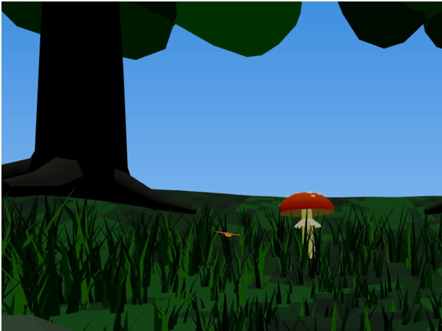
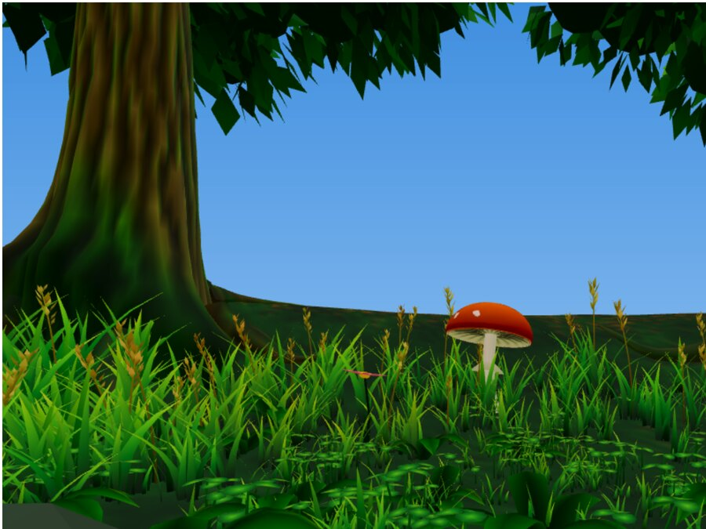
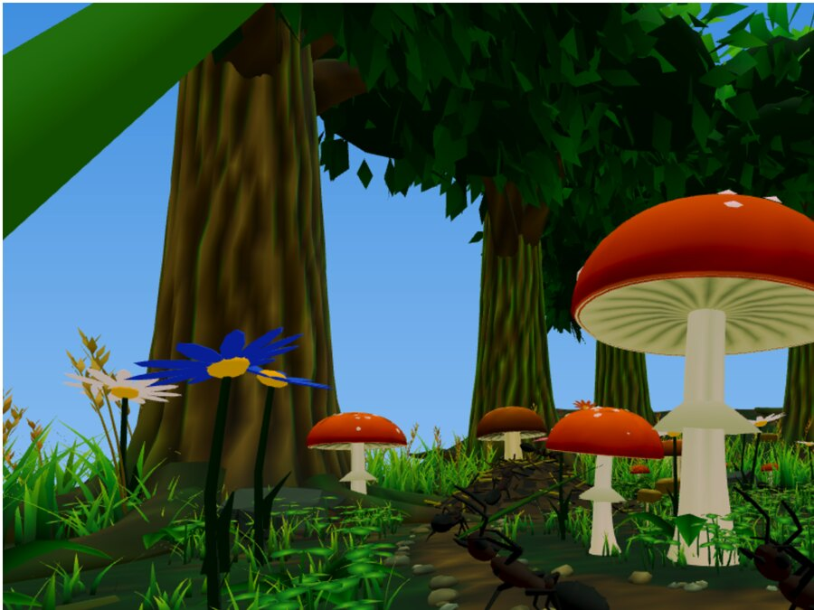

# antforest: new ground, grass, trees and mushrooms for GameApi's ant scene

GameApi's author has a demo in which ants walk a path through a clearing, seen from their own height (the models are at `https://meshpage.org/antscene_*.glb`). `tools/antforest.cpp` writes four of that scene's model files anew: the ground, the grass, the trees and the mushrooms. The ants, the flowers, the hill and the tower stay as they are, and so does the scene's script: the new files have the old names and take the old ones' place.

Before and after, the same view:




Further along the path:



Nothing in the new files comes from anywhere else. There is no downloaded model, texture or photograph in them: every shape and every colour is computed by the program.

## Compile and run

```
c++ -std=c++20 -O2 tools/antforest.cpp -o out/antforest

mkdir -p out/ants/old out/ants/new
for f in ground grass trees mushrooms anthill decor tower $(printf 'ant_%02d ' $(seq 0 17)); do
  curl -s -o out/ants/old/antscene_$f.glb https://meshpage.org/antscene_$f.glb
done
curl -s -o out/ants/old/AI_generated.png https://meshpage.org/AI_generated.png      # a picture the script also loads
out/antforest out/ants/old out/ants/new        # two seconds
```

It reads four of the old files and prints what it wrote:

```
out/ants/new/antscene_ground.glb: 62164 points, 121801 triangles, 3.6 MB
mushrooms: 34
out/ants/new/antscene_mushrooms.glb: 33907 points, 58017 triangles, 2.0 MB
out/ants/new/antscene_grass.glb: 271945 points, 247728 triangles, 11.9 MB
trees: 11 trunks, 132 balls of leaves
out/ants/new/antscene_trees.glb: 175033 points, 172105 triangles, 7.9 MB
```

The program has no dependencies beyond the C++ standard library, and it gives the same files on every run.

## Look at it

The scene is a GameApi script: a list of lines, each naming a model by its URL. Put the four new files where the script finds them, or change the URLs.

To try it on your own machine there is `web/scene.html`, which runs a script file in GameApi's own browser program. That program is built in the engine's `web_page` folder, after the engine itself has been built for the browser as the README's "Building the game" describes:

```
(cd GameApi/GameApi/web_page && make -f Makefile.LinuxEm pthreads_both_highmem EMSCRIPTEN_PATH=$PWD/../../../em/sdk/)
# it ends with an error about brotli, after engine_highmem.js and engine_highmem.wasm are written

mkdir -p out/ants/page
cp web/scene.html GameApi/GameApi/web_page/engine_highmem.{js,wasm} out/ants/page/
cp out/ants/old/* out/ants/page/ && cp out/ants/new/*.glb out/ants/page/     # the new four over the old four
# and the scene's script as out/ants/page/scene.txt
python3 tools/serve.py out/ants/page 8792
```

Then open `http://127.0.0.1:8792/scene.html?from=https://meshpage.org/&to=.` in Chrome: `from` and `to` make the page load the models from this server instead of the one the script names. Here it was run this way in Chrome on Windows with a graphics card. A browser without one (headless Chromium with its software renderer) takes minutes to compile this scene's shaders and is no use for looking.

## How it came about

**What the old files are.** The first step was to open them. Each is one mesh with one material and one small image, written by the author's own generator. The image is a palette of 32 flat colours, and every point of a mesh names one of them, so a blade of grass is one dark green from foot to tip and a trunk one dark brown. All files share one box of coordinates, 16,000 units across with an ant about 150 long, and each starts with a triangle that spans that box. GameApi scales every model it loads to its box, so that triangle is what keeps the files in register with each other. A replacement has to start with the same triangle.

**Why compute and not collect.** The condition was that only free material be used. Freely licensed plants and trees exist, but they come as photographs on flat cards or as detailed models with several textures each, in styles that match neither each other nor the scene's ants and flowers, and each brings a licence to track. A program that computes the shapes has none of that: the result is plainly ours to give away, it keeps the scene's flat, drawn look, and it lands exactly where the old pieces were. So the work became a generator.

**Where things stand.** The ants' walk, the flowers and the hill are fixed in the other files, so nothing could move. The program therefore reads the old files and keeps their layout. From the old ground it takes the height of every place and where the bare earth of the path is (the triangles with one of the palette's three browns). From the old grass, where each of the 10,440 blades stands, how tall it is and which way it leans (the old blades are eight triangles each, one after another). The old trees and mushrooms are found as the connected pieces of their meshes: a piece of 120 triangles is a trunk, one of 80 a ball of leaves, one of 210 a mushroom's cap, whose colour says which kind it is.

**Where the look comes from.** Three things did most of it.

- *Colour that changes along a shape.* The new image has eight bands (grass, leaves, bark, straw, earth, caps, pale, stone). Across a band the colour runs from shade to light; down a band it runs from one kind to another: fresh grass to dry, bark to moss, bare earth to green floor, red cap to brown. A point picks its place in both directions, so a blade is dark at the foot and light at the tip and yellows towards it, and moss fades into bark without an edge.
- *Light worked out beforehand.* The engine's own light left the old trunks black. Here each point's shade is decided by where it is: the foot of a blade and the furrows of the bark are dark, the top of a crown light and its underside darker but never black. It looks lit whatever the engine does.
- *Shapes with a few more points where it shows.* A blade is a ribbon of four or five pieces that bends over and ends in a point; its edges' normals are turned outward so it reads as rounded. A trunk is a tube with wide ribs at the foot, one for each root, and furrowed bark; the roots run out over the ground, following its height. A crown is a dark ball with seventy leaves standing out of it, which gives a leafy outline instead of a blob. A mushroom has gills (every other line darker), a stem that thickens at the foot, and by kind white warts and a ring, a thick brown cap, or a wavy yellow one. The ground is the old heights on a finer, smooth net, mottled, with small stones beside the path.

Between the blades stand things the old scene did not have: stalks with ears of seeds, patches of clover, rosettes of broad leaves. Patches of taller and shorter, fresher and drier grass keep it from being one carpet.

**Looking.** Each change was judged by eye in the running scene, with pictures taken from the browser at fixed seconds, the old scene beside the new. The first pictures were too dark (the colours were chosen for a brighter light than the engine gives), the clover was too thick, the bark too regular, and a red spot showed under each cap where the gills did not meet the stem. Those were the rounds.

## What it costs, and what is not done

- The four files are 25 MB where the old ones were 8 MB, and the scene takes 870 to 950 MB of browser memory (two runs) where it took 500 MB. The grass is the largest part. Fewer second blades (`make_grass`) or fewer leaves per lump (`leaves`) bring it down.
- The scene was looked at in the browser on one graphics card. On the desktop the engine did not load the files from a local server, so it was not looked at there.
- Bark seen from far away still reads as stripes.
- The anthill, the flowers and the tower are the old ones.

## Licence

`tools/antforest.cpp` is under this repository's licence (Apache 2.0). The files it writes contain nothing but what it computes; use them as you like.
